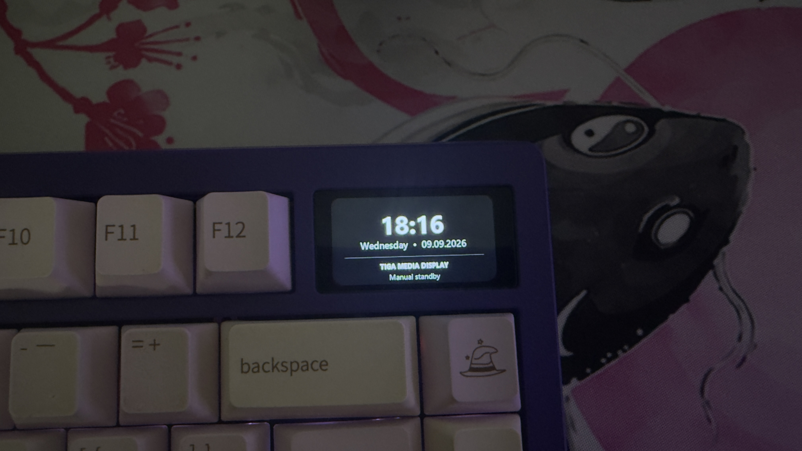

# TIGA Windows Media Display


Turn the **Meletrix / Wuque Studio Zoom75 TIGA** LCD into a Windows-wide **Now Playing** display.

TIGA Windows Media Display reads the active Windows media session, renders artwork and metadata for the TIGA's **320×172** screen, and uploads the frame over a reverse-engineered BLE media-transfer path.

**No Spotify API. No cloud account. No Meletrix kernel driver.**

> **Unofficial community project.** This project is not affiliated with or endorsed by Meletrix / Wuque Studio.

## Download

### [Download the Windows installer →](https://github.com/MichiG21/tiga-zoom75-windows-media-display/releases)

For normal use, download the newest file named similar to `TIGA-Windows-Media-Display-Setup-v0.2.0-beta.1.exe` from the **Assets** section of the newest release.

The installer bundles the application and its runtime dependencies, so normal users do **not** need to install Python, Pillow, Rust or Cargo, Visual Studio / C++ Build Tools, or Developer PowerShell.

The current public installer is a **beta**. Testing and issue reports are very welcome.

## Preview

| Now Playing | Standby | Upload transition |
|---|---|---|
|  |  |  |
| Cover art, title, artist / creator, album, and total duration when the active Windows media source exposes it. | When no fresh media is playing, a clean clock-and-date standby screen. | While a new frame is being committed, the TIGA may briefly show its built-in roar animation before the new image appears. |

## Features

- Uses Windows **Global System Media Transport Controls (GSMTC)** instead of a Spotify-specific API.
- Works with Spotify and other applications that expose a Windows media session.
- Displays artwork, title, artist / creator, album, and total duration when available.
- Japanese, Chinese, Korean and symbol titles display, using fonts that ship with Windows (Yu Gothic, Microsoft YaHei / JhengHei, Malgun Gothic, Segoe UI Symbol). Titles written in Morse code also get a decoded line.
- Large clock-and-date standby screen.
- Ignores stale remembered media at login until playback is proven fresh.
- Returns to standby after playback has been paused or stopped for **60 seconds**.
- Uses keyboard progress notifications as BLE flow-control instead of blindly pacing writes.
- Full custom-frame upload typically takes about **8 seconds** on the original development unit.
- Includes a Windows display-control utility for automatic mode, standby, black screen, and standby + shutdown.
- Starts automatically at user logon through a Windows Scheduled Task.
- Does **not** require the blocked / vulnerable `meletrixid.sys` kernel driver.
- Installs per-user under LocalAppData and does not require an administrator install.

## Quick start

1. **Connect the keyboard.** Plug the Zoom75 TIGA into the PC with its **USB-C cable**. This is how it's used on the development unit: it types over the cable, in wired mode. The wireless typing modes (Bluetooth, 2.4 GHz) haven't been tested with this project.

   The PC also needs **Bluetooth turned on**. The images for the screen are not sent over the cable: they go over Bluetooth Low Energy to the keyboard's display, which advertises itself as `Zoom75 Tiga`. **You don't need to pair it in Windows' Bluetooth settings.** The app finds the display by itself and connects to it directly. On the development PC the keyboard isn't paired at all. The keyboard may also show up as `Zoom75 Tiga BT1`; that's its Bluetooth typing connection, and the app ignores it.
2. **Install.** Download the newest Windows installer from the [Releases page](https://github.com/MichiG21/tiga-zoom75-windows-media-display/releases) and run it. The installer places the application under `%LOCALAPPDATA%\Programs\TIGA Windows Media Display` and creates a Scheduled Task named `TIGA Windows Media Display`. The display stack is started automatically after installation and again at user logon.
3. **Use the Start Menu shortcuts:** **Display Control**, **Start Display**, **Stop Display** and **Status**. That is all normal users need for everyday use.

> Windows SmartScreen may warn about early beta installers because the executable is not currently code-signed. Only download releases from this GitHub repository.

## Display Control

The included display-control utility can request:

- **Automatic** — follow fresh Windows media sessions
- **Standby** — show the clock/date standby screen
- **Black Screen**
- **Standby + Shut Down** — requests standby, waits for the BLE upload, then shuts Windows down

The renderer returns to normal automatic behavior when launched normally.

## Known limitations

The project is functional on the original Windows development system and Zoom75 TIGA unit and now has a public Windows installer. The current release is still a **public beta**. Additional testing across Windows systems, Bluetooth adapters, TIGA firmware revisions, and media applications is welcome.

- The TIGA can briefly show its built-in roar animation during a custom-image upload.
- If a BLE upload stops partway through with the keyboard simply going quiet, the stack retries it by itself after 2 minutes, up to 3 times. Only if that fails, or if the upload had been slowing down first, does it halt and ask you to reset the keyboard: the TIGA has no power switch, and unplugging USB doesn't reset it — it has a battery. Open the case, disconnect the battery from the PCB, and wait at least 30 seconds, pressing a few keys while it's disconnected. Reconnect, then run `START_STACK.ps1`. See [BLE upload was interrupted](#ble-upload-was-interrupted-uploader-halted).
- The renderer keeps the historical filename `tiga_windows_nowplaying_v2.py` internally for compatibility with the existing stack.
- An existing older/manual installation may have its `TIGA Windows Media Display` Scheduled Task replaced by the installer.

Please report installation, Bluetooth, display, startup, or media-detection problems through [GitHub Issues](https://github.com/MichiG21/tiga-zoom75-windows-media-display/issues).

## Troubleshooting

### TIGA stays on the stock roar animation

Wait for the current upload to finish first. If the custom frame never appears, use the installed **Status** shortcut and inspect the local logs in the installation directory. **Status** reports the last frame rendered and the last frame actually delivered to the keyboard (`OK`, `PENDING` or `STALLED`), not just whether the processes are running.

### BLE upload was interrupted (uploader halted)

If an upload stops partway through, the keyboard is left holding an unfinished media session.

**Most interruptions recover by themselves.** When the transfer was running at a normal pace and the keyboard simply stopped answering (the usual case), the stack waits 2 minutes and tries again, up to 3 times, without you doing anything. Testing on 2026-10-18 showed that such a retry works about as often as any first upload (roughly 2 times in 3) and needs no reset. While it waits, **Status** says `RETRYING - … automatic retry 1 of 3 at …`, and `logs\startup_supervisor.log` records each retry and its result.

If all three retries fail, or if the upload had been getting slower and slower before it stopped (a state retrying doesn't fix), the BLE uploader halts, the Now Playing renderer keeps running, and **Status** reports:

```
Status        : HALTED - transfer interrupted after CONTROL2 ...
Action        : Disconnect the keyboard's battery for at least 30 s (there is no power switch; ...
```

To recover:

1. **The TIGA has no power switch, and unplugging USB doesn't reset it** — it has a battery. Open the case, disconnect the battery from the PCB, and wait **at least 30 seconds**, pressing a few keys while it's disconnected. Reconnect. A 10–15 second disconnect was not enough in testing.
2. Run **Start Display** (`START_STACK.ps1`). Running it by hand is how you say "I have reset the keyboard": it clears the halt (`logs\uploader_halted.json`) and starts the uploader again. Nothing clears the halt automatically.

More cases (keyboard unreachable, turning it off on purpose, missing duration, logs): [docs/BUILD_AND_RECOVERY.md](docs/BUILD_AND_RECOVERY.md#troubleshooting).

## For developers

- [How it works, media-session behaviour, BLE uploader, privacy, repository layout, reverse-engineering](docs/ARCHITECTURE.md)
- [Build from source, manual BLE test, detailed troubleshooting and recovery](docs/BUILD_AND_RECOVERY.md)
- [BLE protocol notes](docs/PROTOCOL_NOTES.md) · [DLX container format](docs/DLX_FORMAT.md)
- [Uploader failure classes and the retry / halt policy](docs/design/RETRY_RECOVERY.md)
- [Project history and decisions](docs/PROJECT_HISTORY.md) · [Release checklist](docs/RELEASE_CHECKLIST.md)

## Contributing

Issues and pull requests are welcome; see [`.github/CONTRIBUTING.md`](.github/CONTRIBUTING.md).

## Disclaimer

This is an unofficial community project.

Use it at your own risk. No warranty is provided. Firmware, protocol behavior, and compatibility can change between keyboard revisions or software versions.

This project is not affiliated with, sponsored by, or endorsed by Meletrix or Wuque Studio.

## License

TIGA Windows Media Display is licensed under the **GNU General Public License, version 2** (GPL-2.0-only). That's the license of [meletricks](https://github.com/athdesk/meletricks) by hdesk / athdesk, whose code-loading work on the TIGA's display MCU this project plans to build on. Using the same license keeps that combination possible.

See [`LICENSE`](LICENSE) for the full text.

Releases up to and including **v0.2.0-beta.1** were published under the MIT License, and those copies remain MIT. Everything after that is GPL-2.0.

Some reference material has its own copyright or license terms. See [`THIRD_PARTY_NOTICES.md`](THIRD_PARTY_NOTICES.md).
